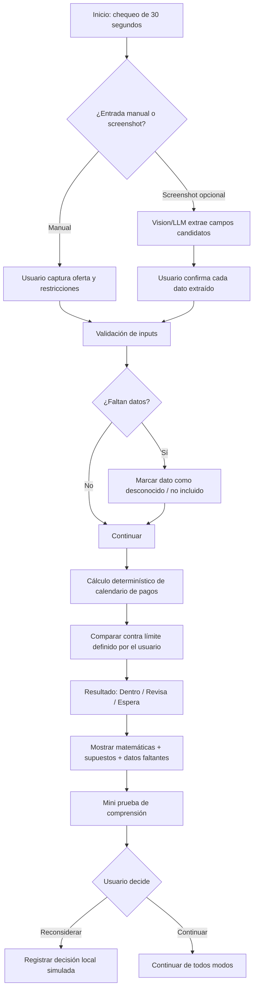
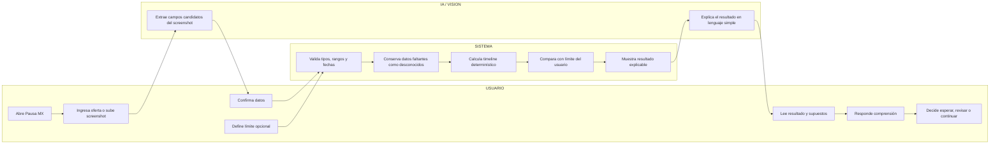

# WEEK 10 BUSINESS BENDING — PACKET

**Student:** Diego Gil  
**Role:** USER  
**Chapter:** Isle of Happiness  
**Declared vacuum:** DEBT GUARDRAILS  
**Product:** Pausa MX — Chequeo de Cuotas  
**Build slice:** 30-second pre-purchase installment check + user comprehension test  
**Product language:** Spanish (Mexico)  
**Documentation language:** English

## 1. Problem in my own words

Mexican shoppers can accept installment offers in seconds, but the decision screen is optimized to remove friction, not to help the buyer understand the consequences under their own constraints.

The user problem is not simply “credit is bad.” The problem is that the buyer sees one monthly payment while the real decision depends on existing payments, essential expenses, due dates, unknown fees, and the spending limit the buyer wants to respect.

From the USER lens, the key question is:

> **At the exact moment someone is about to accept installments, what would make them voluntarily add 30 seconds of friction to understand the commitment before buying?**

Pausa MX is a buyer-controlled pre-purchase check. It does not approve, reject, rank, block, lend, or buy. It translates one installment offer into a simple payment timeline and compares it with a limit the user sets for themselves.

Missing fees, debts, or dates stay visibly unknown instead of being guessed.

## 2. Exact user

**Primary user hypothesis:** a Mexican shopper with a tight or variable monthly budget who is considering a purchase in installments through a marketplace, social-commerce feed, BNPL provider, or retailer checkout.

**Synthetic build persona: Karla, 29, Estado de México — fictional / synthetic**
- Uses WhatsApp, Instagram, Mercado Libre, and banking apps.
- Does not use spreadsheets for personal finance.
- Understands the monthly installment shown at checkout but does not always map it against other monthly commitments.
- Has essential expenses and more than one recurring payment.
- Wants a fast answer, not a budgeting lecture.
- Will abandon the tool if it feels judgmental, slow, or asks for bank credentials.
- Wants to remain in control even if the tool says “wait.”

Karla is a synthetic build persona, not presented as real user research.

## 3. Success definition

**Before the module closes, this works at a live URL:**

1. The user completes the core check in about 30 seconds with manual entry.
2. The user enters purchase price, installments, installment amount if known, first due date, known fees, essential monthly expenses, existing monthly installment commitments, and an optional self-set monthly limit.
3. Every field is validated and bounded.
4. Financial math is deterministic code, never LLM arithmetic.
5. Missing fees, debts, or dates remain labeled **unknown / not included**.
6. The app returns one advisory state:
   - **Dentro de tu límite**
   - **Revisa antes de comprar**
   - **Espera**
7. The result shows the math, assumptions, and missing data.
8. The user can always continue. The app never blocks a purchase.
9. Optional screenshot upload can extract candidate offer fields using vision/LLM, but the user must confirm every extracted amount before calculation.
10. AI-generated extraction or explanation is visibly labeled AI-assisted or simulated.
11. The app includes a short comprehension check:
   - “¿Cuánto pagarías en total?”
   - “¿Cuánto se suma a tus pagos el próximo mes?”
   - “¿Qué dato sigue faltando?”
12. The demo does not require bank login or store real financial data.
13. `npm test` and `npm run build` pass.
14. There are at least two production deploys, including one after a documented bug fix.

## 4. IMAGE-GENERATED mockup

**Target file:** `assets/mockup-pausa-mx.png`

Mockup requirements:
- Mobile-first Spanish utility.
- Header: **Pausa MX**
- Subtitle: **“30 segundos antes de aceptar otra compra a meses.”**
- Purchase card:
  - Precio: `$3,000 MXN`
  - `6 pagos`
  - Próximo pago: `$500`
- Existing commitments: `$1,200 / mes`
- User-set limit: `$2,000 / mes`
- Result: **REVISAR ANTES DE COMPRAR**
- Upcoming payment timeline.
- Disclosure: **“No vemos todas tus deudas. Solo usamos lo que tú confirmas.”**
- CTA: **“Ver por qué”**
- Secondary action: **“Continuar de todos modos”**
- Shadow statement: **“Tú decides. Pausa MX no bloquea compras ni decide por ti.”**

The visual should feel like a trustworthy buyer-side finance utility, not a lender, retailer, or shopping feed.

## 5. Feature flow — Mermaid

## 6. Swimlane — Mermaid

**Boundary:** AI can extract and explain. It cannot perform the authoritative financial calculation, change the user’s limit, block a purchase, lend money, or make the final decision.

## 7. Benchmark line

**Best existing solution on Earth:** consumer-facing AI shopping assistants such as Google Shopping / agentic shopping flows demonstrate that AI can interpret offers and intervene before checkout.

**Mine differs/localizes by:** Pausa MX is explicitly buyer-loyal, built around Mexican installment decisions, manual-first user constraints, fragmented obligations, and the ability to recommend waiting without retailer or lender incentives.

Supporting benchmark: Klarna-style shopping and installment interfaces prove that installment information can be embedded in purchase flows, but Pausa MX reverses the success metric from conversion/credit usage to comprehension under the buyer’s own constraints.

## 8. Three-year long view

In three years, Pausa MX becomes a buyer-side financial decision layer that can understand screenshots, receipts, installment plans, recurring commitments, and user-defined limits across fragmented Mexican commerce. It becomes the shopper’s agent before checkout, while preserving a hard separation between **showing consequences** and **granting permission**. The load-bearing walls remain buyer control, visible assumptions, independent advice, no conversion-linked incentives, and no claim of complete financial visibility unless the data truly supports it.

## 9. Scope cut

Not building:
- a store,
- seller recommendations,
- product discovery,
- lending,
- BNPL underwriting,
- credit scoring,
- automatic checkout,
- automatic borrowing,
- purchase blocking,
- bank aggregation,
- real debt-provider integrations,
- retailer affiliate links,
- lender referral fees,
- a full budgeting app,
- debt payoff planning,
- hidden financial-health scores,
- real financial-data persistence.

The slice is only:

> **one purchase + known commitments + user-set limit → transparent payment timeline → buyer-controlled pause signal → comprehension test.**

## 10. Blueprint conditions translated into product rules

### Condition 1 — Buyer control / shadow clause
- Never block.
- Never auto-purchase.
- Never change the user’s limit.
- Limits are optional, editable, and reversible.
- Result is advisory.
- Always provide “Continuar de todos modos.”

### Condition 2 — Honest inputs
- User confirms extracted values.
- Missing fees remain unknown.
- Missing debts remain “not included.”
- Missing dates remain unknown.
- Never claim a complete financial picture.

### Condition 3 — Privacy by design
- Manual-first.
- No bank login.
- No real financial data in demo seeds.
- Browser-local synthetic/demo state only.

### Condition 4 — Independent advice
- No retailer affiliate links.
- No lender referral fees.
- No sponsor can change the result.
- No conversion KPI.

### Condition 5 — Test against simple alternatives
- Compare against a basic calculator/calendar.
- Persona test asks whether the user would actually use Pausa MX before checkout.
- The product loses if the extra UX does not improve comprehension over a simple calculator.

### Condition 6 — Economic proof
- Do not claim 10:1.
- Treat it only as a future hypothesis.
- Track cost per check, user-defined avoided fee / avoided purchase value, and willingness to pay or sponsor interest.

## 11. Architecture + stack

| Layer | Tool / approach | Purpose |
|---|---|---|
| Frontend | Next.js + React + TypeScript | Mobile-first Spanish UI |
| Styling | Tailwind CSS | Fast responsive interface |
| User-constraint data | Typed browser-local state | Purchase, commitments, limits, missing-data flags |
| Deterministic finance logic | TypeScript pure functions | Payment schedule, totals, thresholds |
| LLM | Optional server-side OpenAI | Plain-language explanation only |
| Vision | Optional image input to vision-capable model | Extract candidate values from screenshot |
| Validation | Zod | Types, ranges, dates, lengths |
| Tests | Vitest + Testing Library | Logic, validation, workflow, shadow constraints |
| Persistence | None for real user data | Avoid auth/RLS requirement in demo |
| Deployment | Vercel | Live URL |
| Version control | Git + GitHub | Packet-before-code evidence and commit history |

### Dragon Stack

**LLM + user-constraint data + vision**

- **LLM:** explain.
- **User-constraint data:** user’s own budget/commitment context.
- **Vision:** optional screenshot extraction.
- **Deterministic code:** owns the financial math.

## 12. Data model

### PurchaseOffer
- `priceMxn`
- `installmentCount`
- `installmentAmountMxn | null`
- `firstDueDate | null`
- `knownFeesMxn | null`
- `source: manual | screenshot`
- `confirmedByUser: boolean`

### UserConstraints
- `essentialExpensesMxn`
- `existingMonthlyPaymentsMxn`
- `selfSetMonthlyLimitMxn | null`

### MissingData
- `feesUnknown`
- `otherDebtsNotIncluded`
- `dueDateUnknown`

### CheckResult
- `totalKnownCostMxn`
- `monthlyTimeline[]`
- `nextMonthKnownObligationMxn`
- `limitStatus: within | review | wait | no_limit`
- `assumptions[]`
- `unknowns[]`

### ComprehensionAnswer
- `estimatedTotalMxn`
- `estimatedNextMonthMxn`
- `recognizedUnknown: boolean`

No real names, account numbers, card numbers, bank credentials, or real financial histories are required.

## 13. Security floor — before build

1. **No secrets in repo.**
   - `.env*` ignored.
   - `OPENAI_API_KEY` optional and server-side only.
   - Vercel environment variables only.

2. **Personal data rule.**
   - No real personal financial data is persisted remotely.
   - No login required because there is no real user-data persistence.
   - If persistence is added later, implement Supabase Google Auth first.

3. **RLS rule.**
   - Not applicable because no Supabase user-data table exists.
   - If one is introduced, RLS is mandatory before storing anything.

4. **Input validation.**
   - Zod for every form.
   - Positive money values only.
   - Reasonable upper bounds.
   - Real calendar-date validation.
   - No raw text directly into prompts.
   - Screenshot file type and size limits.

5. **Demo data.**
   - Synthetic only.
   - Every demo dataset labeled fictional / simulated.
   - No real names, bank details, screenshots, or financial records.

## 14. Test plan

### Mechanical pass
Test:
1. price positive;
2. installment count bounded;
3. installment amount positive when present;
4. real calendar dates only;
5. fees can be explicitly unknown;
6. incomplete obligations remain visibly incomplete;
7. result never claims full debt visibility;
8. deterministic total correct;
9. monthly timeline correct;
10. changing user limit changes only the advisory signal, not the math;
11. no-limit state stays neutral;
12. “wait” never blocks continuation;
13. screenshot extraction requires confirmation;
14. invalid image files rejected;
15. AI/simulated outputs visibly labeled;
16. AI failure leaves deterministic calculator functional;
17. no lender/retailer links;
18. no hidden risk score;
19. mobile flow usable;
20. `npm test` passes;
21. `npm run build` passes.

Required cycle:
- find at least one real defect;
- document it;
- fix it;
- add regression coverage;
- redeploy.

### Persona pass

**Karla, 29 — fictional / synthetic**
- variable disposable income;
- buys through social / marketplace flows;
- understands monthly payment better than APR-style language;
- distrusts apps asking for bank access;
- impatient at checkout;
- does not want financial scolding.

For each screen ask:
- What does Karla think this tool is?
- What does she think she is being asked to enter?
- What does she hesitate on?
- What wording sounds judgmental?
- Does she understand what is unknown?
- Does she understand what AI did versus what the calculator did?
- Would she actually use this before checkout?
- Does “wait” feel like advice or control?
- Does she know she can continue anyway?
- Can she explain the total obligation after using it?

Log every confusion.
Fix the single worst confusion.
Re-run the walkthrough.
Document remaining risks.

## 15. Acceptance criteria

The slice passes only if:
- primary path is manual-first;
- optional screenshot extraction is secondary;
- every extracted field is confirmed by the user;
- financial calculations are deterministic;
- the LLM never owns the math;
- missing information remains visible;
- the app never claims complete financial visibility;
- user sets their own optional limit;
- user can override every advisory result;
- no transaction is executed;
- no lender or retailer incentive appears;
- no bank credentials are requested;
- simulated AI is labeled;
- no real PII/financial data is in seeds;
- USER comprehension is tested explicitly;
- shadow rule is visible;
- tests/build pass;
- live URL works.

## 16. Commit plan

1. `docs: establish week 10 packet before code`
2. `feat: establish Pausa MX buyer-first shell`
3. `feat: add manual installment and constraint inputs`
4. `feat: add deterministic payment timeline and guardrail result`
5. `feat: add comprehension check and buyer-control states`
6. `feat: add optional screenshot extraction with confirmation`
7. `test: cover finance logic security floor and blueprint constraints`
8. mechanical fix commit
9. persona fix commit

At least two production deploys.

## 17. Session Close rule

Every coding session ends with:
1. update `docs/DECISIONS.md`;
2. record the most important decision;
3. record what changed;
4. record unresolved risk;
5. write **Tomorrow’s first move**;
6. run tests/build;
7. commit;
8. push.

## 18. First implementation principle

**Do not optimize the purchase. Optimize the buyer’s understanding of the purchase.**

If Pausa MX becomes better at making a decision for the user than explaining the consequences to the user, it has crossed the chapter’s shadow line.
